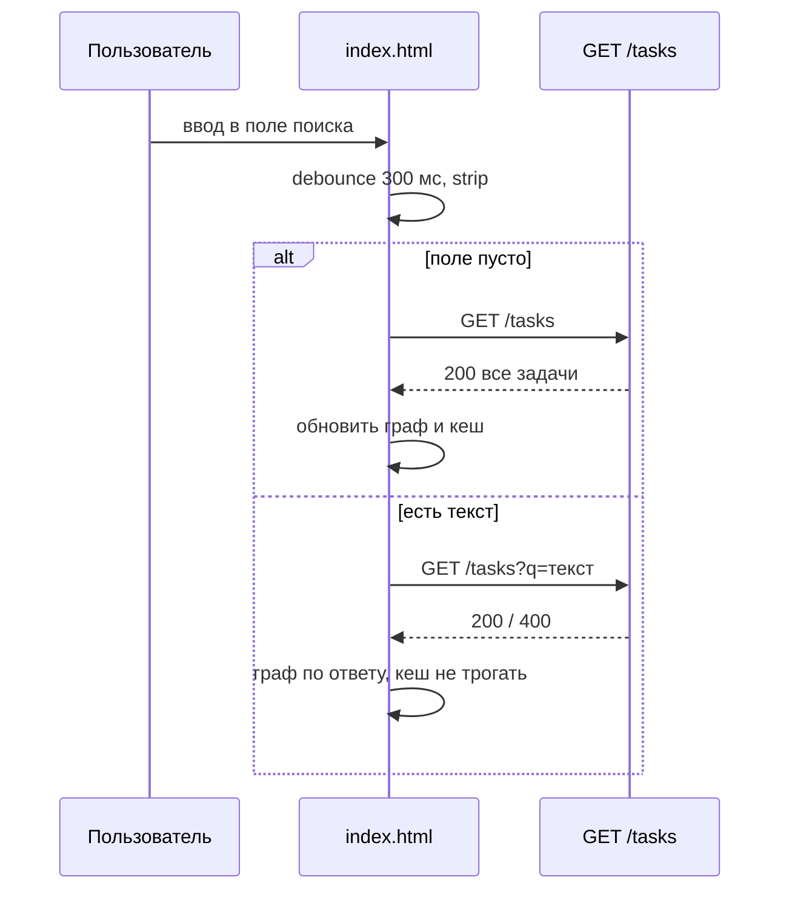

# Design

## Context

Фронт - один файл `app/static/index.html` на чистом JS и d3-force. Загрузка списка уже идёт через `GET /tasks` с таймаутом 3 с и кешем в localStorage (фича B). Мотивация - в proposal.md.

## Goals / Non-Goals

**Goals:**
- Поиск через сервер, без дублирования правил на клиенте.

**Non-Goals:**
- Подсветка совпадений, поиск по тегам, история запросов.

## Decisions

- Фильтрация только на сервере (контракт, решение 1). Альтернатива - фильтр на клиенте: отвергнута, правила разошлись бы с API.
- Debounce 300 мс в самом JS. Альтернатива - запрос на каждый символ: лишняя нагрузка и мигание графа.
- Общая функция загрузки получает необязательный `q`; кеш пишется только когда `q` пуст.
- Устаревшие ответы отбрасываются: применяется ответ последнего запроса.

## Risks / Trade-offs

- Гонка ответов → применять только ответ с последним порядковым номером запроса.
- Баннер сбоя сети перекрывается с «ничего не найдено» → показывать баннер приоритетнее.
