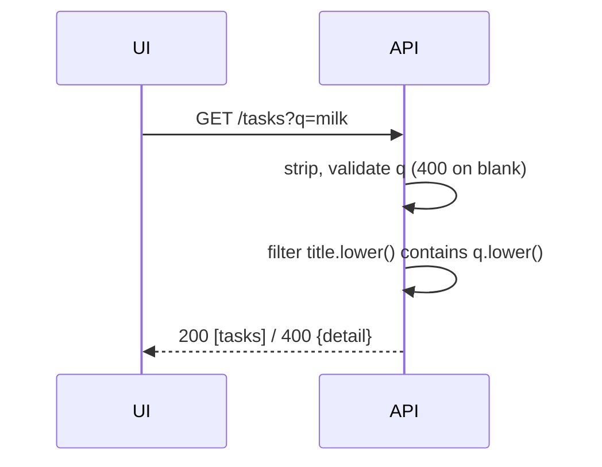

# Implementation Plan: Поиск по названию (API)

**Spec**: [spec.md](spec.md) | **Contract**: [contracts/search-contract.md](contracts/search-contract.md)

## Technical Context
Python 3 / FastAPI / pytest через `TestClient`; in-memory `_tasks`.

## Constitution Check
- Test-First: тесты в `tests/test_search_by_title.py` пишутся первыми - OK.
- Authoritative Backend: фильтрация и валидация только на сервере - OK.
- Minimal Change: правится только `list_tasks` - OK.
- Contract Before Code: контракт согласован с UI-спекой - OK.

## Design
Добавить `q: Optional[str] = Query(None)` рядом с `tag`. Порядок проверок: `tag` (как сейчас) → `q`
(None → пропуск; strip пуст или длина > 100 → 400) → фильтр `q.lower() in t.title.lower()`.

## Risks
Пересечение с `tag`: пустой `tag` проверяется раньше `q`, чтобы сохранить текущее поведение.
