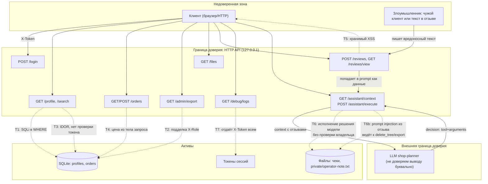

# Модель угроз: Mini Shop

Схема по методологии Microsoft Threat Modeling: активы, границы доверия, векторы атак, меры защиты.

## Угрозы и меры (STRIDE)

| № | Угроза | STRIDE | Мера после фикса |
|---|---|---|---|
| T1 | SQL-инъекция в `/profile`, `/search` | Tampering | Параметризованные запросы (`rows_params`) |
| T2 | Клиент сам задаёт роль через `X-Role` | Spoofing, Elevation of Privilege | Роль берётся из серверной сессии по токену |
| T3 | Чужой профиль читается без токена (IDOR) | Information Disclosure | Обязательный токен, сверка `id` с владельцем сессии |
| T4 | Клиент задаёт цену заказа | Tampering | Цена всегда берётся из каталога на сервере |
| T5 | Хранимый XSS в отзывах | Tampering, Information Disclosure | HTML-экранирование перед рендером |
| T6 | `/assistant/execute` выполняет решение модели без проверки владельца ресурса | Elevation of Privilege | Проверка `path.startswith(f"files/{owner}/")` и роли для каждого инструмента |
| T6b | Prompt injection: вредоносный текст в отзыве маскируется под инструкцию для модели | Elevation of Privilege (через LLM как confused deputy) | То же серверное разграничение T6 — модель может "согласиться" выполнить вредоносное действие, но сервер не даст выполнить его за пределами прав клиента, даже если LLM обманут |
| T7 | `/debug/logs` отдаёт все заголовки, включая токены, без авторизации | Information Disclosure | Доступ только для `staff`, `X-Token` маскируется в выдаче |

Главный вывод по LLM-угрозам: модель как компонент — ненадёжный источник решений (confused deputy). Защита строится не на том, чтобы модель "не поддалась" на prompt injection, а на том, что сервер проверяет права вызывающего клиента независимо от содержимого решения модели (T6/T6b). Это и проверяется тестами `test_assistant_execute_*` в `lab/test_security_before.py` до и после фикса.
